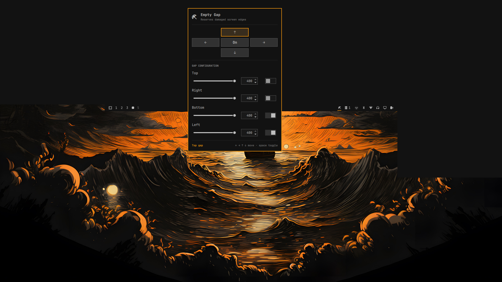

# Empty Gap

[](https://omarchy.org)
[]()

Requires **Omarchy 4.x** for inline settings. Older Omarchy releases are
supported via the legacy top-level config key (see below).

An [Omarchy](https://omarchy.org) shell plugin (Quickshell) that displays **empty strips** along one or more screen edges (up to all four) to reserve damaged monitor areas — e.g. the dark strip at the top of a laptop with a cracked screen.



## Features

- **Bar icon controls**: left click opens the settings panel, right click turns every strip on/off at once, scroll up turns them on and scroll down turns them off.
- **All four edges**: reserve **Top / Right / Bottom / Left** simultaneously — each edge has its own height and transparency.
- **Gap buttons**: a diamond of five icon buttons — the edge arrows
  `↑ ← → ↓` and the master in the centre — drawn in the shape of the screen
  edges they toggle. Each edge button toggles that strip and stays
  accent-tinted while it is on; the centre button is the one with a label,
  reading `On` / `Off` with the master state, and turns every strip on or
  off. Tooltips and the status line name the button under the cursor.
- **Any height**: drag the slider for 0–200 px, or type an exact 0–400 px in
  the number field next to it (0 = strip exists but reserves no space).
- **Transparent**: per edge — use the bar theme color or go fully transparent.
- **Original bar stays visible**: if the Omarchy bar sits on the same edge as the strip, the bar is pushed inward (to the inner side of the strip) instead of being covered by it.
- **Independent**: the strip does not follow `omarchy toggle bar` or the original bar's transparency toggle.
- **Live reload**: every change is saved to `shell.json` and applied immediately.
- **Keyboard**: open the panel from the bar button (or from a shortcut you
  add yourself — see [Keyboard shortcut](#keyboard-shortcut-optional)).
  Inside the panel the cursor starts on the **Top** gap button;
  `↑↓←→` (or `hjkl`) move around the button diamond and then through the
  configuration rows and their three controls; `Space` toggles the focused
  gap or switch and starts a fresh number on a height input; typing digits
  while the cursor — or just the pointer — is on a height input sets that
  strip's height directly, with `Backspace` removing the last digit; and
  `Tab` / `Shift + Tab` hop to the next/previous bar widget. `Escape`
  leaves the slider editor or closes the popup, like the other Omarchy
  panels.
- **No keys taken over**: the plugin registers no keybinding, spawns no
  external process, and never edits `~/.config/hypr/`. It cannot shadow or
  evict a binding you already use; the optional `SUPER + CTRL + G` toggle is
  yours to add (see [Keyboard shortcut](#keyboard-shortcut-optional)).
- **One highlight at a time**: hovering a control moves the same cursor the
  keyboard uses, so exactly one gap button or one configuration control is
  highlighted — never a whole row or section. A status line under the rows
  names the current target and the keys that act on it.

## Installation

```bash
omarchy plugin add https://github.com/syaifulmain/omarchy-empty-gap.git --enable
```

During the interactive install, pick the bar section for the button (default: *right*).

Once installed, the 󱢊 icon button appears on the bar:

| Input | Action |
| --- | --- |
| Left click | Open the settings panel |
| Right click | Toggle all strips on/off |
| Scroll up | Turn all strips on |
| Scroll down | Turn all strips off |

The icon shows 󱢊 when the master switch is on and 󱢋 when it is off.

No keyboard shortcut is registered for you — add one yourself if you want it.

## Keyboard shortcut (optional)

The plugin registers no keybinding. It runs no external command, never touches
`~/.config/hypr/`, and never unbinds keys you already use, so it cannot shadow
or evict an existing binding. If you want a keyboard toggle, add it like any
other Omarchy binding.

On **Omarchy 4.x**, append this to `~/.config/hypr/bindings.lua`:

```lua
o.bind("SUPER + CTRL + G", "Empty Gap panel", "omarchy-shell shell toggle syaifulmain.emptygap")
```

Then apply it with `hyprctl reload` (or use Omarchy's own reload path); the
binding is a normal one from then on and behaves like every other Omarchy
binding across theme changes and updates.

On **older Omarchy releases**, bind the same command in your Hyprland config:

```conf
bind = SUPER CTRL, G, exec, omarchy-shell shell toggle syaifulmain.emptygap
```

`omarchy-shell shell toggle` resolves the live widget instance on each monitor,
so the same line works whether the bar has one Empty Gap button or several.
Pick whichever key combo suits you — nothing in the plugin depends on
`SUPER + CTRL + G`.

## Update

Pull the latest version from the repository:

```bash
omarchy plugin update syaifulmain.emptygap --yes
```

Then reload the shell so the new code takes effect (e.g. log out and back
in, or restart the shell).

## Remove

```bash
omarchy plugin remove syaifulmain.emptygap --yes
```

This deletes the plugin from `~/.config/omarchy/plugins/` and removes its
entry from the bar layout. Any strips currently on screen disappear after
the shell reloads.

## Usage

The **Empty Gap** button panel contains:

| Control | Function |
| --- | --- |
| `↑` / `←` / `→` / `↓` edge buttons | Enable/disable that edge (accent = active) |
| Centre button (`On` / `Off`) | Master on/off for every strip |
| Per-edge row: slider | Strip height for that edge, dragged in 2 px steps (0–200) |
| Per-edge row: input | Exact height, typed or stepped (0–400 px; 0 = no space reserved) |
| Per-edge row: switch | Transparent strip or theme background |
| Status line | Names the focused control and the keys that act on it |

All four rows are always listed — a disabled edge is dimmed but keeps its
height and transparency editable, so a strip can be configured before it is
switched on.

All values are stored inline on the widget entry in `~/.config/omarchy/shell.json`:

```json
"bar": {
  "layout": {
    "right": [
      {
        "id": "syaifulmain.emptygap",
        "enabled": true,
        "edges": {
          "top":    { "enabled": true,  "height": 26,  "transparent": true  },
          "right":  { "enabled": false, "height": 40,  "transparent": false },
          "bottom": { "enabled": false, "height": 40,  "transparent": false },
          "left":   { "enabled": false, "height": 40,  "transparent": false }
        }
      }
    ]
  }
}
```

## Compatibility

Works on both Omarchy 4.x and older releases:

- **Omarchy 4.x**: settings are stored inline on the widget entry in
  `bar.layout` (see the example above) and are written through
  `shell.updateEntryInline`.
- **Older Omarchy**: settings live under a top-level `syaifulmain.emptygap`
  key in shell.json and are written through `shell.mutateShellConfig`; the
  strips are rendered by the `service` entry point (`Shim.qml`), which is
  inert on 4.x.
- **Keyboard shortcut**: registered on neither host. On 4.x the toggle is an
  `o.bind(...)` line in `~/.config/hypr/bindings.lua`; on older releases it is
  a classic `bind =` line in the Hyprland config. See
  [Keyboard shortcut](#keyboard-shortcut-optional).
- **Upgrading Omarchy from an old release with this plugin installed**: the
  legacy top-level key is no longer readable on 4.x, so strips stay off until
  you open the Empty Gap panel once and toggle an edge — the settings are
  then written inline on the widget entry and persist from there.

Legacy single-edge configs (`"edge"`, `"height"`, `"transparent"`) are
migrated automatically on read.

## How it works

The strip is a layer-shell `PanelWindow` on `WlrLayer.Bottom` with the namespace
`syaifulmain-emptygap`. Because the compositor processes the bottom layer first, the
strip claims the outermost screen edge (exclusive zone) and the Omarchy bar on
the same edge is automatically pushed inward — to the inner side of the strip.

## Verify installation

```bash
omarchy plugin list            # syaifulmain.emptygap should appear
hyprctl layers | grep emptygap # strip is active
```

## Structure

```text
manifest.json   # plugin metadata (id: syaifulmain.emptygap, kinds: service + bar-widget)
Shim.qml        # service (pre-4.x hosts): one PanelWindow strip per enabled edge
Panel.qml       # bar-widget: button + settings panel + strips (4.x) / dual-host config
```

## Changelog

See [CHANGELOG.md](CHANGELOG.md).

## License

[MIT](LICENSE)
